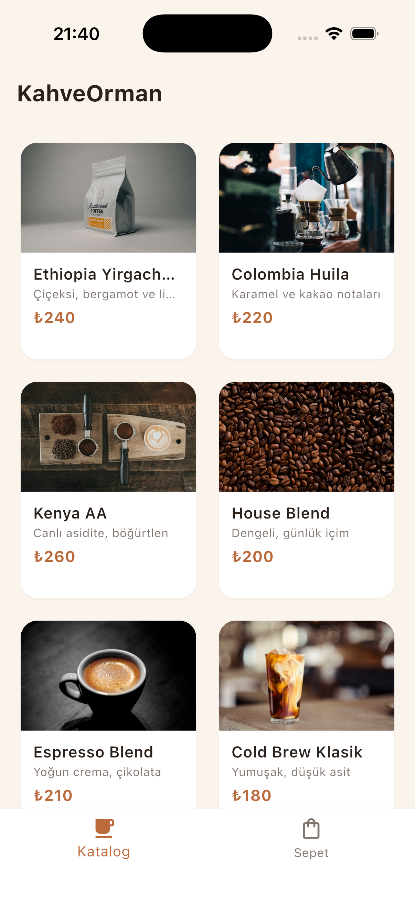
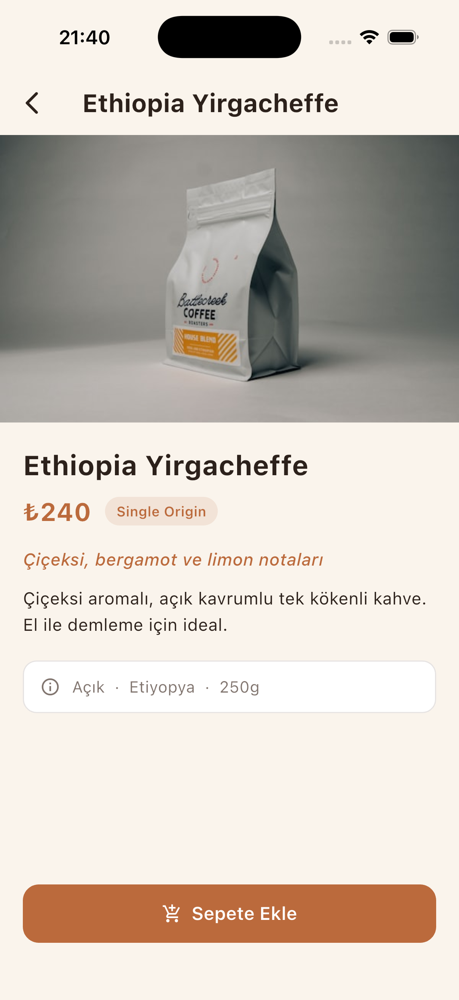
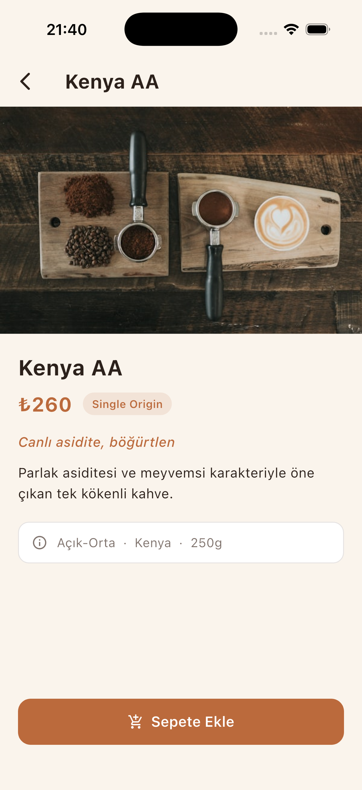
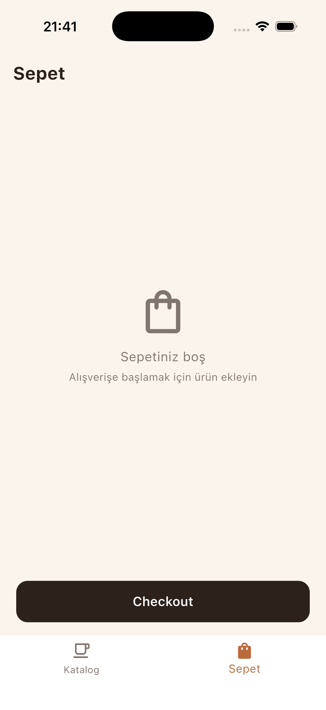
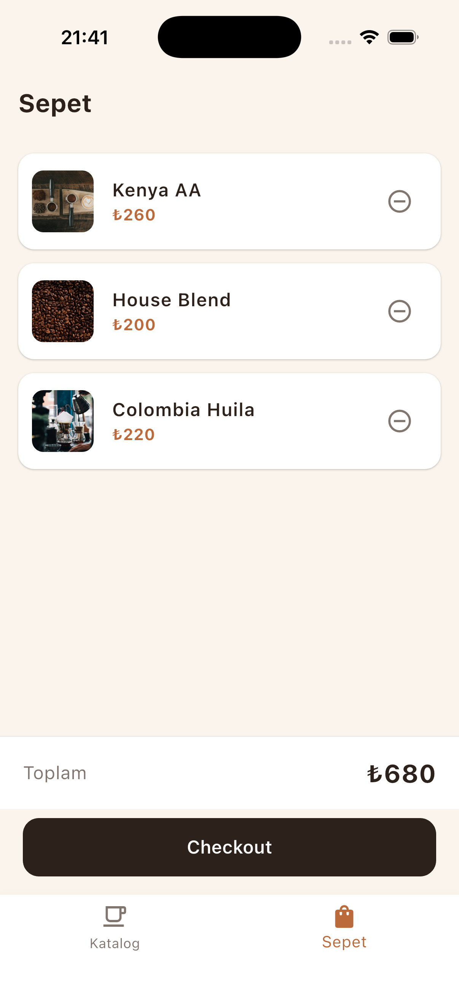
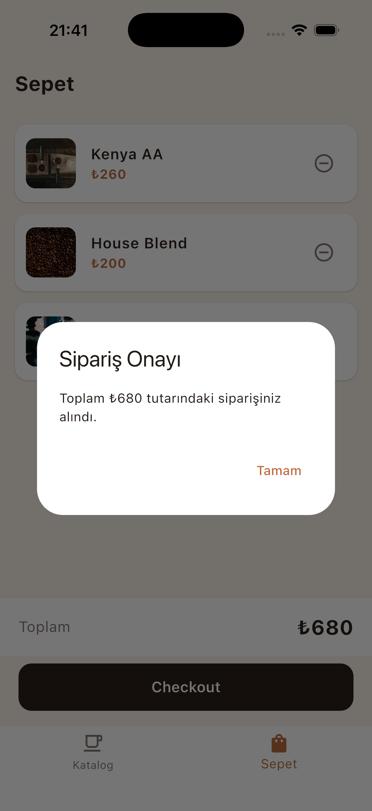
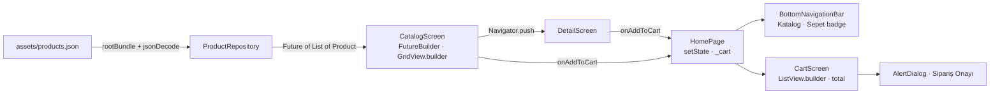

<div align="center">



<p>
  
  
  
  
</p>

<p><em>A mini catalogue app for a specialty coffee shop: product grid, product detail and a cart,<br>
written with nothing but Flutter's material library and Dart's built-ins.</em></p>

<table>
  <tr>
    <td width="16%"></td>
    <td width="16%"></td>
    <td width="16%"></td>
    <td width="16%"></td>
    <td width="16%"></td>
    <td width="16%"></td>
  </tr>
  <tr>
    <td align="center"><sub>Katalog</sub></td><td align="center"><sub>Detay</sub></td><td align="center"><sub>Detay</sub></td><td align="center"><sub>Boş sepet</sub></td><td align="center"><sub>Sepet</sub></td><td align="center"><sub>Sipariş onayı</sub></td>
  </tr>
</table>

</div>


## The idea

The Flutter edition of [KahveOrman](https://github.com/kutluhangil/KahveOrman), written as the last of four assignments in an internship's Flutter / mobile module. The brief was strict on purpose: show the core of Flutter and nothing else. One `material.dart` import, Dart's own `dart:convert` and `rootBundle`, no state management package, no HTTP client, no fonts package.

> **Small by design.** About 800 lines of Dart in nine files. Everything the app does is a standard Flutter building block you can point at: `FutureBuilder`, `GridView.builder`, `Navigator.push`, `setState`, `ListView.builder`, `SnackBar`, `AlertDialog`.


## Features

| | |
|---|---|
| **Catalogue** | A two-column `GridView.builder` of product cards with photo, name, tagline and price, loaded through a `FutureBuilder` with a loading spinner and an error state. |
| **Product detail** | Opened with `Navigator.push`, the product passed through the constructor. Large photo, tasting notes, roast, origin and weight chips, and the description. |
| **Add to cart** | "Sepete Ekle" adds the product and shows a short `SnackBar`; the cart tab's badge counts the items. |
| **Cart** | A `ListView.builder` with thumbnails and a remove button per line, an empty state, and the running total. |
| **Checkout** | On an empty cart a SnackBar says so; otherwise an `AlertDialog` confirms the order with its total and clears the cart. |
| **Images that fail well** | Network photos have a loading indicator and a fallback tile if the image cannot load. |
| **Coffee theme** | A five-colour palette (cream, white, espresso, muted, caramel) in `theme.dart`, applied through `ThemeData`. |
| **Turkish UI** | All interface text and code comments are in Turkish. |


## How it fits together



The cart lives in one place, `HomePage`, and is handed down as a list plus callbacks (`onAddToCart`, `onRemove`, `onCheckout`). That is the whole state story, which was the point of the exercise.


## The menu

Eight products in `assets/products.json`, each with `id`, `name`, `price`, `category`, `image`, `tagline`, `description`, `roast`, `origin` and `weight`:

| Product | Category | Roast | Price |
|---|---|---|---|
| Ethiopia Yirgacheffe | Single Origin | Light | ₺240 |
| Colombia Huila | Single Origin | Medium | ₺220 |
| Kenya AA | Single Origin | Light-medium | ₺260 |
| House Blend | Blend | Medium | ₺200 |
| Espresso Blend | Blend | Dark | ₺210 |
| Cold Brew Klasik | Cold Brew | Medium | ₺180 |
| V60 Dripper | Equipment | – | ₺260 |
| Filtre Kagidi 100lu | Accessories | – | ₺90 |

<sub>Prices are sample data for the assignment. Product photos are loaded from Unsplash.</sub>


## Türkçe özet

**KahveOrman Flutter**, bir specialty kahve dükkânı için yazılmış Flutter mini katalog uygulaması; bir stajın Flutter / mobil modülündeki dört ödevlik serinin sonuncusu. Ürünler `assets/products.json`'dan okunuyor, `GridView` ile listeleniyor, `Navigator` ile detay sayfası açılıyor, sepet `setState` ile tutuluyor ve sipariş bir onay penceresiyle tamamlanıyor. Uygulama yalnızca `material.dart` ve Dart'ın dahili kütüphaneleriyle yazıldı; ek paket yok.


## Running it

```sh
flutter pub get
flutter run          # Android emulator or iOS simulator
flutter test         # widget test: the bottom bar shows Katalog and Sepet
```

```
lib/main.dart                     app entry, theme
lib/theme.dart                    KahveOrman colours and ThemeData
lib/models/product.dart           Product with fromJson / toJson
lib/data/product_repository.dart  reads assets/products.json
lib/screens/                      home_page, catalog_screen, detail_screen, cart_screen
lib/widgets/product_card.dart     one grid card
assets/products.json              the eight products
assets/images/                    screenshots
```

<div align="center">
<br>
<a href="https://github.com/kutluhangil"></a>
<sub>Internship assignment · see also the web version, KahveOrman.</sub>
</div>
