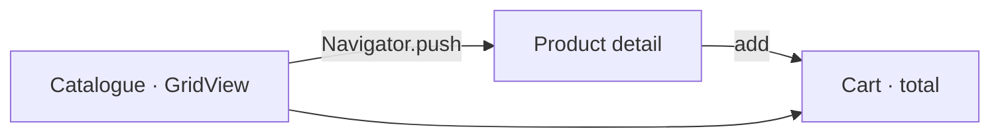

<div align="center">


<p>
  
  
  
  
</p>

<p><em>A mini catalogue app for a specialty coffee shop: product list, product detail and a cart,<br>
written with nothing but Flutter's material library and Dart's built-ins.</em></p>

</div>


## What it is

The Flutter edition of KahveOrman, built as the final project of a mobile development (Android / iOS) course. The goal was to show the core of Flutter cleanly: a grid of products, navigation to a detail page with data passed through the constructor, and a simple cart.

| | |
|---|---|
| **Catalogue** | A two-column `GridView.builder` of cards with image, name, short description and price. |
| **Product detail** | Opened with `Navigator.push`; the product is passed through the constructor. |
| **Cart** | Add products and see the running total. |
| **No dependencies** | Only `material.dart` and Dart's own libraries. |




## Türkçe özet

**KahveOrman Flutter**, bir specialty kahve dükkânı için geliştirilmiş Flutter mini katalog uygulaması; mobil uygulama geliştirme (Android / iOS) eğitiminin proje ödevi. Ürün listesi, ürün detayı ve sepet akışı var. Uygulama yalnızca `material.dart` ve Dart'ın dahili kütüphaneleriyle yazıldı.


## Running it

```sh
flutter pub get
flutter run
flutter test
```

<div align="center">
<br>
<a href="https://github.com/kutluhangil"></a>
<sub>Course project · see also the web version, KahveOrman.</sub>
</div>
